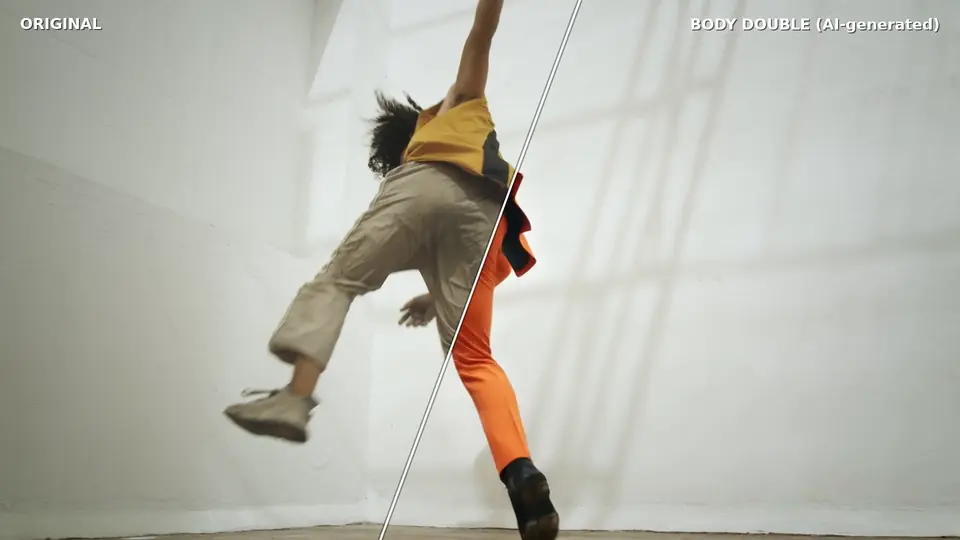
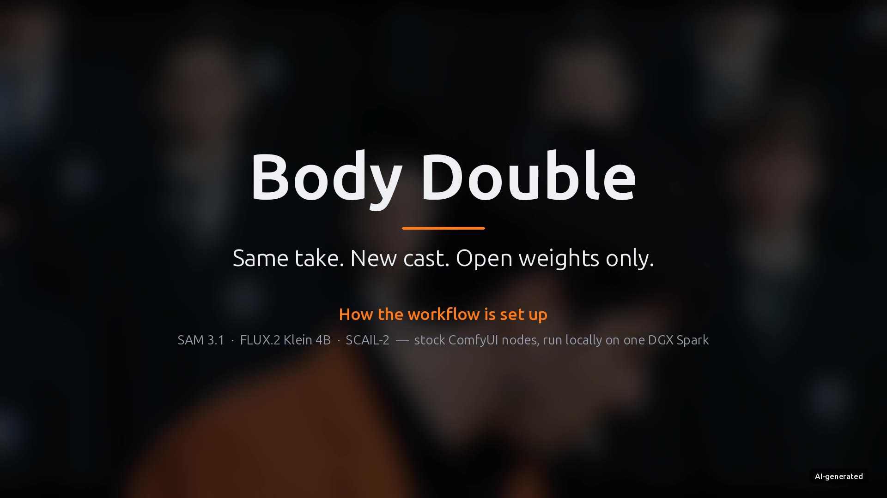

# Body Double

[](media/body_double_demo.mp4)

_Left of the line: the original take, a [Mixkit stock clip](https://mixkit.co/free-stock-video/man-breakdancing-452/).
Right: the same take recast by Body Double as an original fictional character (AI-generated). This is a 15 s preview;
click it for the full 30 s at 1080p._

[](media/body_double_explainer.mp4)

_GitHub doesn't play mp4 files from a repository inline. Click the poster to open the explainer (1:59, 1080p, with sound)._
<!-- For an inline player: drag media/body_double_explainer.mp4 into this README's editor on github.com and replace the link above with the resulting user-attachments URL. -->

**Same take. New cast. Open weights only.**

Body Double is an entry for Comfy's [Open Source Higgsfield challenge](https://comfy.org/open-source-higgsfield)
(#OpenSourceHiggsfield). It's an open alternative to Higgsfield Genjutsu that runs locally on stock ComfyUI.

## What it does

Body Double recasts the performer in a video as a new character. Their motion, the camera move, the rest of the shot
and the original audio are kept.

- **Follow-cam recasting.** SCAIL-2 does badly on small people, and replacement mode re-synthesises the whole frame.
  Body Double tracks the performer with SAM 3.1 and renders a virtual camera that keeps them large at the model's
  resolution. Only the recast performer is pasted back into the untouched full-resolution plate, so the crowd, the
  set and the grain stay pixel-identical.
- **Re-identification.** If the track loses the performer (a turn, an occlusion, a pull-back into a crowd), Body
  Double re-detects everyone and picks the performer again by appearance.
- **Open first frame.** FLUX.2 Klein 4B paints the new character into the real first frame (four options). That
  frame anchors identity for the whole take.
- **Long takes.** Each 81-frame segment is its own ComfyUI job, conditioned on the previous segment's last five
  frames, with a per-segment seed and colour match. QC (seam ratio and background drift) runs before the next segment
  starts, and a flagged segment is re-rolled. Runs resume after a crash.
- **Core nodes only.** No custom node packs, partner nodes or closed APIs.

## How it works

| Stage | What runs | Models |
|---|---|---|
| conform | ffmpeg: full-res frames, audio, 960-wide tracking proxy (HDR tone-mapped) | — |
| detect, track | SAM3_Detect picks the performer, then windowed SAM3_VideoTrack with re-identification | SAM 3.1 |
| crops | A smoothed follow-cam crop per frame, at the model's size | — |
| anchor | Two-image edit of the first crop frame: the performer becomes the cast | FLUX.2 Klein 4B |
| segments | One `WanSCAILToVideo` replacement job per 81 frames, with 5-frame overlap and QC | SCAIL-2 int8 + DPO LoRA + lightx2v, UMT5, CLIP-H, Wan VAE |
| assemble | Paste the recast performer into the plate inside the dilated source ∪ cast masks; mux audio | — |

Segment math: chunk k starts at frame 76k and is at most 81 frames. The last chunk is padded to 4n+1 frames and
trimmed after assembly, so F frames in gives F frames out (`tests/test_plan.py`).

The runner (`bodydouble/runner.py`) builds each graph in `bodydouble/graphs.py` and queues it through comfy-sdk and
comfy-api-proxy. Example graphs with placeholder file names are in `workflows/api/` (API format) and `workflows/ui/`
(open in the ComfyUI frontend to inspect). `scripts/export_workflows.py` and `scripts/export_ui_workflows.py`
regenerate them.

The 30-second, 720-frame demo take (1280×704 follow-cam, 1920×1080 composite) took 80 minutes for its 10 segments
and 11 minutes to assemble on one NVIDIA DGX Spark (GB10).

## Quick start

Tested on DGX Spark (aarch64) with ComfyUI at commit `7cebca52`; x86_64 Linux is untested. Needs `uv`, `git`,
`ffmpeg`, `ffprobe`, `curl` and `sha256sum`. ComfyUI is expected at `$HOME/ComfyUI` (set `COMFYUI_DIR` or pass
`--comfyui=/path`); `setup.sh` clones it at the tested commit if it's missing.

```bash
./setup.sh --accept-sam-license    # app venv, ~43 GB of models (sha256-checked), node/model check
./run.sh                           # ComfyUI :8188 + comfy-api-proxy :8189 on loopback
./run.sh --check                   # verify nodes and core models against the running server
.venv/bin/python -m bodydouble.runner myjob --src clip.mp4 --cast character.png --prompt "who the new cast is"
```

`--accept-sam-license` accepts Meta's SAM License for SAM 3.1. Outputs go to `runs/<job>/<take>/`: the composite at
source resolution, plus the follow-cam crop. `.venv/bin/python -m bodydouble.runner --help` lists every option.

Tests: `uv pip install -p .venv -e '.[test]' && .venv/bin/python -m pytest -q`

### Cast images and props

Leave held props (a cigarette, phone or microphone) out of the cast image and the prompt. SCAIL-2 draws them from the
source video wherever the performer holds one; a prop in the references pops in where the performer has none. Before a
take's first segment the runner stops if SAM 3.1 finds one on the cast or the prompt names one (`--props` sets the
list); `--cast-edit "Remove the cigarette. Keep everything else the same."` cleans the cast locally with FLUX.2 Klein.

## Open weights only

Every model in the pipeline is open weights: SAM 3.1, FLUX.2 Klein 4B, and SCAIL-2 (Wan 2.1 14B) with DPO, lightx2v
and optional relight LoRAs. The graphs use stock ComfyUI nodes, driven locally through comfy-sdk and comfy-api-proxy.
There are no closed generation APIs or partner nodes in the pipeline, and no custom node packs.

## Models and licenses

See [MODELS.md](MODELS.md). Weights are downloaded from their official upstreams by `setup.sh` and are never
redistributed here; each keeps its own license. MiniMax H3 is not used (MODELS.md explains why).

The repository license, [Apache-2.0](LICENSE), covers code and workflow files only (see [NOTICE](NOTICE)).

## AI-generated content

Body Double's outputs are AI-generated. Keep an AI-generated label on them wherever they are published. The
demo and the explainer carry one.

## Content rights

Use footage you have the rights to and characters you own or have permission to use. The basis for the demo footage
and character is recorded in [RIGHTS.md](RIGHTS.md).

## Explainer credits

The explainer's narration and music were made with Gemini 3.8 Flash TTS and Lyria 3 Pro via Replicate. They are
AI-generated and not part of the pipeline. `explainer/` holds the scripts that made the video (`make_vo.py`,
`make_music.py`, `make_explainer.py`). They are video tooling, not part of Body Double: the first two call Replicate
with `REPLICATE_API_TOKEN` from the environment, and `make_explainer.py` renders from a finished demo run, which is
not included here.

## Challenge

Built for Comfy's [Open Source Higgsfield challenge](https://comfy.org/open-source-higgsfield). #OpenSourceHiggsfield
